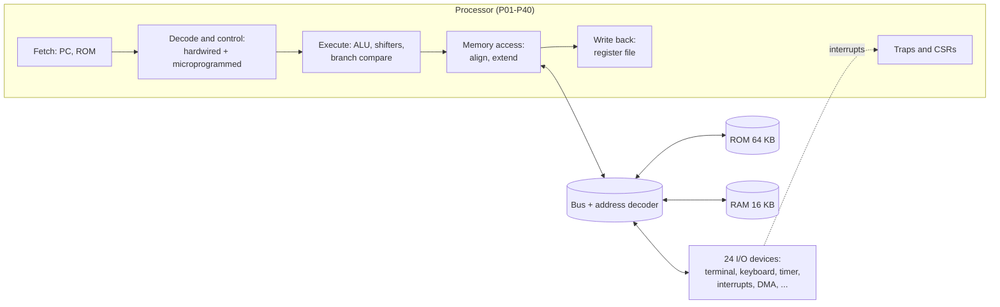

# RC-V: the computer our class builds

**RC-V** (Ramanujan College RISC-V) is a complete, working computer designed by the
66 students of *Computer System Architecture* (B.Sc. (H) Computer Science, Semester 1,
Section 1, 2026-27). Every student builds **one package**: one hardware block, the
same block in Verilog, one RISC-V program and a short dossier. Put together, the 66
packages make a 32-bit RISC-V processor with memory, a terminal, a keyboard, a timer,
interrupts, DMA, a cache model and more. It boots and runs every student's program.



| Start here | |
|---|---|
| New to GitHub, Digital or Verilog? | [docs/GETTING-STARTED.md](docs/GETTING-STARTED.md) |
| How to hand in work (fork, pull request, review) | [docs/WORKFLOW.md](docs/WORKFLOW.md) |
| Rules, marks and the two-week timeline | [docs/PROJECT.md](docs/PROJECT.md) |
| How the computer works | [docs/ARCHITECTURE.md](docs/ARCHITECTURE.md) |
| The instructions and the assembler | [docs/ISA.md](docs/ISA.md) |
| All 66 packages | [docs/PACKAGES.md](docs/PACKAGES.md) |
| Live progress of the whole class | the class board (GitHub Pages of this repository) |

## How to join

1. Make sure you are signed in to GitHub.
2. Open **Issues → New issue → Join RC-V**, paste the join code from your slip, submit.
3. A bot answers within a minute with your package. Then follow
   [docs/GETTING-STARTED.md](docs/GETTING-STARTED.md).

Do not put your name or roll number anywhere in this repository: it is public. Your
GitHub account is enough; your teacher knows which code belongs to whom.

## What is in here

| Folder | Owner | Contents |
|---|---|---|
| `packages/PNN-name/` | one student each | the four hand-in files, the task (README.md) and its tests |
| `shared/` | teacher | the top-level wiring (`rtl/rcv_soc.v`), test bench, package list |
| `sw/lib/` | teacher | start-up code and the library every program may call |
| `tools/rcv/` | teacher | assembler, cycle-exact simulator, checker, generators |
| `docs/` | teacher | everything you need to read |

## Running things on your own laptop (optional)

GitHub checks everything when you open a pull request, so you only need Digital
on your laptop. If you also have Python 3:

```bash
cd tools
python -m rcv.progrun 17 ../packages/P17-ifields/p17.s --input-file ../packages/P17-ifields/tests/program/test1.in
python -m rcv.check 17
python -m rcv.classrom --demo
```

## Credits

Designed for the class by the course teacher. Digital is by H. Neemann
(GPL-3.0); Icarus Verilog by S. Williams. The processor follows the RISC-V RV32I
specification (a subset). The textbook links (Mano; Patterson and Hennessy) are in
docs/ARCHITECTURE.md.
