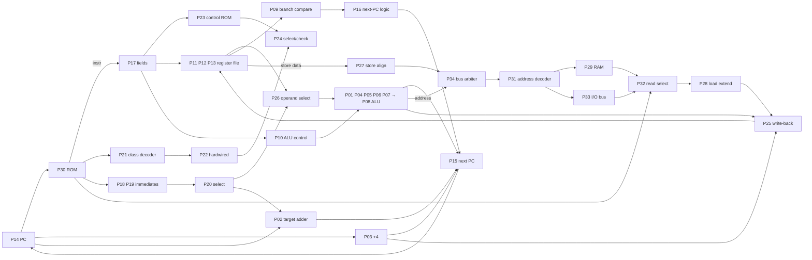

# How RC-V works

RC-V is a **single-cycle** 32-bit RISC-V processor: every clock cycle fetches one
instruction, decodes it, executes it, accesses memory if needed and writes the result
back. (A real processor would overlap these steps in a pipeline; P58 and P59 measure what
that would mean.) The only exception is the DMA controller, which can *steal* cycles,
and then the processor waits.

The top level that wires all 66 blocks together is `shared/rtl/rcv_soc.v`. Read it next
to this page: each `pNN_...` line there is one student's module.

## The datapath

Traps and interrupts: P40 (illegal instruction), P39 (trap decision), P37 (CSRs:
mstatus, mtvec, mepc, mcause, mscratch), P38 (CSR read-modify-write), P47 (interrupt
controller), P62 (latency meter). Reset: P66.

## The instruction cycle in one clock

| Step | What happens | Blocks |
|---|---|---|
| Fetch | ROM[PC] gives the instruction | P14, P30 |
| Decode | fields, class, control word, immediate, read rs1 and rs2 | P17, P21, P22/P23, P24, P18-P20, P13 |
| Execute | ALU operation, branch condition, branch target | P26, P10, P01-P08, P09, P02 |
| Memory | address decode, RAM/ROM/I/O read or write | P27, P34, P31, P29, P33, P32, P28 |
| Write back | choose ALU / memory / PC+4 / CSR value, write rd | P25, P11, P12 |
| Next PC | PC+4, branch/jump target, trap vector or mepc | P03, P16, P15 |
| Interrupt check | if an enabled interrupt is pending, the instruction is not executed: mepc ← PC, PC ← mtvec | P47, P39, P37 |

This is the same instruction cycle as Mano's Basic Computer (fetch, decode, execute,
interrupt cycle), done in one clock instead of the timing signals T0, T1, ...

## Control word (P22 and P23 both produce it)

| Bit | Name | Meaning |
|---|---|---|
| 15 | (unused) | always 0 |
| 14 | regwrite | write the result to register rd |
| 13 | asel_pc | ALU input A = PC (AUIPC) |
| 12 | bsel_imm | ALU input B = immediate (not rs2) |
| 11 | a_zero | ALU input A = 0 (LUI) |
| 10 | memread | load |
| 9 | memwrite | store |
| 8-7 | wbsel | 0 ALU, 1 memory, 2 PC+4, 3 CSR |
| 6-4 | immsel | 0 I, 1 S, 2 B, 3 U, 4 J |
| 3 | is_branch | conditional branch |
| 2 | is_jal | JAL |
| 1 | is_jalr | JALR |
| 0 | is_csr | SYSTEM opcode (CSR instructions, ECALL, MRET) |

| Opcode | Class | Control word (hex) |
|---|---|---|
| 0110111 | LUI | 5830 |
| 0010111 | AUIPC | 7030 |
| 1101111 | JAL | 4144 |
| 1100111 | JALR | 5102 |
| 1100011 | BRANCH | 0028 |
| 0000011 | LOAD | 5480 |
| 0100011 | STORE | 1210 |
| 0010011 | OP-IMM | 5000 |
| 0110011 | OP | 4000 |
| 1110011 | SYSTEM | 4181 |

**Hardwired vs microprogrammed (Unit 4):** P22 computes each bit with logic gates; P23
reads the same word from a control memory addressed by the opcode. P24 chooses one of
them (`use_rom`) and raises `mismatch` whenever they disagree, so the class can run the
computer both ways and check that the two control units really are equivalent.

## Memory map

| Address | Size | What |
|---|---|---|
| 0x0000_0000 - 0x0000_FFFF | 64 KB | ROM: code, constants (`.rodata`), initial data |
| 0x0001_0000 - 0x0001_3FFF | 16 KB | RAM: data, stack (sp starts at 0x0001_4000) |
| 0x0002_0000 - 0x0002_07FF | 2 KB | I/O: 32 device slots x 64 bytes |

Device slot *k* starts at `0x0002_0000 + 64k`; register *r* is at `+4r`. Register 15 of
every device reads its package number, so a program can find every device (P33 does).
The assembler knows every register by name, e.g. `TIMER_COUNT`, `UART_TXDATA`.

| Slot | Device | Package | Registers (0, 1, 2, ...) |
|---|---|---|---|
| 0 | terminal | P41 | TXDATA, TXSTATUS |
| 1 | keyboard | P42 | RXDATA, RXSTATUS, PEEK |
| 2 | LEDs, display, buttons | P43 | LEDS, SEG, BUTTONS |
| 3 | timer | P46 | COUNT, CMP, CTRL, STATUS |
| 4 | interrupt controller | P47 | PENDING, MASK, CAUSE, SWI |
| 5 | DMA | P48 | SRC, DST, LEN, CTRL, STATUS |
| 6 | performance counters | P49 | CYCLE, INSTRET, CLEAR |
| 7 | cache statistics | P36 (+P35) | HITS, MISSES, CLEAR |
| 8 | multiplier | P50 | A, B, CTRL, STATUS, RESULT |
| 9 | 4-lane vector unit | P51 | A, B, SUM, MAX, SUB |
| 10 | binary to BCD | P52 | BIN, BCD |
| 11 | watchdog | P53 | LOAD, CTRL, STATUS, COUNT, KICK |
| 12 | random numbers | P54 | SEED, VALUE, PEEK |
| 13 | stack guard | P55 | LIMIT, STATUS, MINSP |
| 14 | instruction mix | P56 | LOADS, STORES, BRANCHES, TAKEN, JUMPS, CLEAR |
| 15 | halt | P57 | HALT, CODE |
| 16 | branch predictor | P58 | BRANCHES, CORRECT, CLEAR |
| 17 | hazard meter | P59 | LOADUSE, RAW1, CLEAR |
| 18 | parity | P60 | DATA, PARITY, ODD |
| 19 | text screen | P61 | CHAR, CURSOR, CLEAR, READ |
| 20 | interrupt latency | P62 | LAST, MAX, CLEAR, COUNT |
| 21 | hardware stack | P63 | PUSH, POP, TOP, COUNT, STATUS |
| 22 | code converter | P64 | VAL, GRAY, FROMGRAY, XS3 |
| 23 | complements | P65 | VAL, ONES, TWOS, SIGNMAG, NINES, TENS |

Every device has the same bus ports: `clk, rst, sel, we, re, ridx[3:0], wdata[31:0] →
rdata[31:0]`. A write happens at the clock edge when `sel & we`; `rdata` always shows
register `ridx`; a read with a side effect (keyboard RXDATA, random VALUE, stack POP)
takes effect at the clock edge when `sel & re`.

## Interrupts

Sources (P47): 0 timer, 1 keyboard, 2 DMA done, 3 stack guard, 4 software (SWI). An
interrupt is taken when the source is pending, its MASK bit is 1 and mstatus.MIE (bit 3)
is 1. Then mepc ← PC, mcause ← 0x80000010 + source, MIE ← 0, PC ← mtvec. `mret`
returns. ECALL gives mcause 11, an illegal instruction mcause 2 (mepc points at the
instruction, so a handler adds 4 to skip it).

## RC-V and Mano's Basic Computer (bridge for the exam)

| Mano Basic Computer | RC-V (RISC-V) |
|---|---|
| one accumulator AC, plus DR, AR, TR | 31 general registers x1-x31 (x0 = 0) |
| 16-bit instruction: I, opcode (3 bits), address (12 bits) | 32-bit instruction, six formats (R, I, S, B, U, J) |
| memory-reference instructions (AND, ADD, LDA, STA, BUN, BSA, ISZ) | only LW/LB/LBU/SW/SB touch memory (load-store architecture) |
| register-reference instructions (CLA, CMA, INC, SZA, ...) | ALU instructions on registers: ADD, SUB, XOR, SLLI, ... |
| indirect addressing with the I bit | base + offset addressing: `lw a0, 8(sp)` |
| BSA (save return address in memory) | JAL/JALR save the return address in a register (ra) |
| I/O instructions INP, OUT, SKI, SKO, ION, IOF | memory-mapped I/O: ordinary loads/stores to device registers |
| FGI/FGO flags | RXSTATUS/TXSTATUS registers |
| interrupt cycle: M[0] ← PC, PC ← 1, IEN ← 0 | trap: mepc ← PC, PC ← mtvec, MIE ← 0 |
| timing signals T0..T6 from a sequence counter | one clock per instruction (single-cycle) |
| common bus with select lines S2 S1 S0 | multiplexers choose each block's inputs (P08, P15, P25, P26, P32, P33) |
| hardwired control from D0-D7 and T0-T6 | hardwired (P22) **and** microprogrammed (P23) control, switchable |

Further reading: M. Morris Mano, *Computer System Architecture*, chapters 5 and 8;
Patterson and Hennessy, *Computer Organization and Design (RISC-V edition)*, chapter 4.
